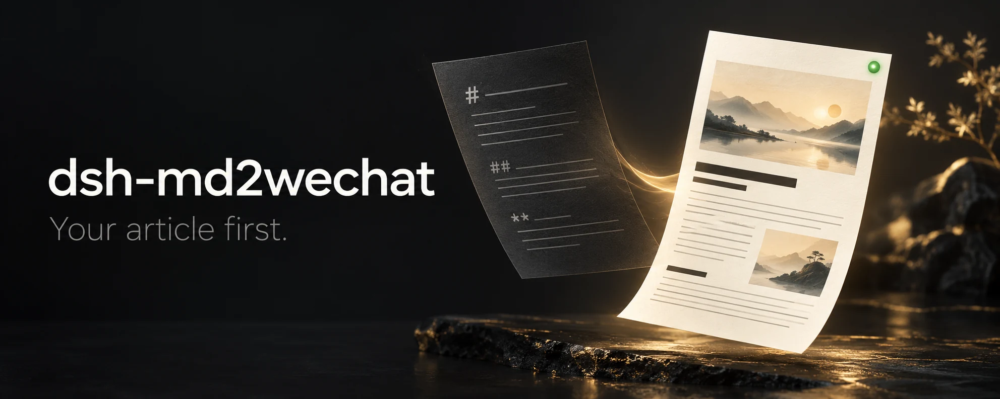

# dsh-md2wechat



**Your article first. Tools in the background.**

Turn a Markdown article into a reviewed WeChat layout inside [DeepSeek Harness](https://github.com/deepseek-ai/deepseek-harness). Compare themes, choose edits and images, then export the HTML you reviewed or save an unpublished draft.

[](./LICENSE)
[](./package.json)

[Get started](#get-started) · [Choose images](#choose-images) · [Export or save a draft](#export-or-save-a-draft) · [Troubleshooting](#troubleshooting)

> **Release status:** the creator workspace is on `main`, but is not yet in a published release. The [v1.0.0 archive](https://github.com/geekjourneyx/dsh-md2wechat/releases/tag/v1.0.0) contains the earlier tool-based workflow. Build from source below to try the workspace. Real-browser and live-service acceptance remain release checks.

## Start with an article, not a tool checklist

Ask your DSH agent:

```text
Open article.md in the WeChat creator workspace.
Keep my source unchanged; let me review the layout and choose any changes.
```

The agent opens one native workspace card. You stay in DSH, not a separate website.

1. **See the article.** Approve sending article content to the configured layout service, then compare real previews, available themes and 320, 375 or 390 px reading widths.
2. **Choose what improves it.** Review up to three exact before/after suggestions. Apply one, keep the original or undo.
3. **Add images if they help.** Pick a cover or place a body image beside a supported paragraph. Nothing is selected for you.
4. **Take away what you reviewed.** Export portable HTML, or prepare the selected WeChat images, review again and confirm an unpublished draft.

Your source stays unchanged. Theme selections and applying edits do not ask a model to reinterpret your click. The plugin never publishes or mass-sends.

**Tested path:** packed-plugin installation and the creator flow have been exercised against the pinned official host with a loopback renderer and simulated WeChat writes. See the [acceptance harness](./scripts/creator-host-acceptance/README.md) for scope and limits.

## Get started

### 1. Check the requirements

- **DSH host and web client:** `0.2.1-rc.2`, the pinned integration target. Other versions, including `0.1.0-rc.5`, are not claimed compatible.
- **Runtime:** Node.js `^22.19.0` or `>=24.0.0`; `dsh` and pnpm `11.7.0` available.
- **Renderer:** a separately installed `md2wechat` CLI at exactly version `3.3.0`.
- **Workspace:** your Markdown and any local images inside the current session workspace.
- **Credentials:** `MD2WECHAT_API_KEY` in DSH's credential service for preview/export. WeChat and image-provider credentials are only needed for their optional operations.

The plugin and its GitHub Release do not contain or install md2wechat. Neither the host nor CLI is upgraded automatically. The plugin archive is platform-independent; check the external CLI distributor for platform support.

### 2. Build and install the current workspace

Clone this repository and run these commands from its root. No sibling DeepSeek Harness checkout is required.

```sh
git clone https://github.com/geekjourneyx/dsh-md2wechat.git
cd dsh-md2wechat
pnpm install --frozen-lockfile
pnpm pack --pack-destination ./dist

# Replace this with your installed CLI's absolute executable path.
export MD2WECHAT_BINARY_PATH=/absolute/path/to/md2wechat
dsh plugin --profile web add ./dist/geekjourneyx-dsh-md2wechat-1.0.0.tgz
```

Keep `MD2WECHAT_BINARY_PATH` available when starting the profile. The locally built archive still uses the package version `1.0.0`; it is **not** the old published archive, even though the filename matches.

Verify the installation and composed configuration, then restart the profile so host and client load the same package:

```sh
dsh plugin --profile web why @geekjourneyx/dsh-md2wechat
dsh --profile web --dump-config
```

Activation stops before tool registration if the configured CLI is missing, has the wrong version or lacks a required command. Add the preview credential in DSH, open an article using the example above, then approve its first preview.

<details>
<summary>Looking for the earlier tool-based v1.0.0 release?</summary>

This installs the earlier release, **not the creator workspace**. Its package targets DSH `0.1.0-rc.5`, not the host version above. See the [v1.0.0 README](https://github.com/geekjourneyx/dsh-md2wechat/blob/v1.0.0/README.md) for legacy usage.

```sh
dsh plugin --profile web add https://github.com/geekjourneyx/dsh-md2wechat/releases/download/v1.0.0/geekjourneyx-dsh-md2wechat-1.0.0.tgz
```

</details>

## Review the real output

Preview sends article content to the configured layout service after approval; it is not an offline Markdown renderer. Suggestions use your existing host agent.

- Compare successful previews. A failed refresh keeps the previous result visible but marks it stale.
- Review the actual publication title returned by the service, including front-matter precedence, rather than assuming it matches the source heading.
- Refresh and review after changes to content, theme or selection. Expired or stale previews cannot stand in for a current review.
- Ordinary HTML export embeds verified local images **before** review, then copies those exact bytes. It needs no cover, image generation or WeChat credentials.
- Existing WeChat image URLs remain remote. Other remote image hosts prompt you to import a local image instead because the protected preview cannot display them.

Browser rendering is isolated; pixel-identical appearance in every WeChat client is not guaranteed.

## Choose images

**Start with a local image or the host's existing image capability.** Imported PNG, JPEG, GIF and WebP files must be inside the session workspace and pass validation. Importing a candidate does not select or upload it.

A cover request asks for three candidates. Body candidates belong to a specific paragraph, with controls to place, replace or remove the image. Positions inside code, YAML front matter, lists, tables, quotes, raw HTML and custom modules are deliberately excluded rather than guessed.

<details>
<summary>Optional CLI fallback: generation also uploads every candidate</summary>

Use fallback generation only when the current DSH agent has no other image-generation capability.

CLI 3.3.0 fallback **generates and uploads every requested candidate to WeChat material storage**, including unused candidates. It can incur provider charges and requires separate one-time approval. Deselecting a candidate does not reverse an upload or charge. Wait for background work to finish before using its results.

Provider settings come from the DSH host environment, not the article directory: `IMAGE_PROVIDER`, `IMAGE_API_BASE`, `IMAGE_MODEL` and `IMAGE_SIZE`. Supported providers are OpenAI, ModelScope, OpenRouter, Volcengine and Tuzi; Tuzi needs an explicit HTTPS API base. Approval names the destination origin. Unsupported or ambiguous settings fail closed.

</details>

## Export or save a draft

**Just need a local HTML file?** Review the current preview and export to a workspace destination. No cover or upload step is required.

For WeChat-ready delivery:

1. Choose one cover and the body images to keep.
2. Approve preparation: upload only that cover and the current local body images. Unselected local candidates are excluded; earlier fallback uploads are not reversed.
3. Review the final HTML after local image references have been replaced with verified WeChat material URLs.
4. Export those exact bytes, or explicitly confirm one **unpublished** draft using that HTML and the selected cover.

Preview, upload/generation, file export and draft creation have separate approvals. Pre-upload review is not approval of a changed final document. If an upload or draft outcome is unknown, inspect the WeChat account before recovery; the plugin does not automatically reissue an uncertain write.

## Configuration

The bundled patch reads `MD2WECHAT_BINARY_PATH` and resolves these credential references through DSH:

| Reference | Purpose |
|---|---|
| `MD2WECHAT_API_KEY` | Layout preview and authentication of reviewed output |
| `WECHAT_APPID`, `WECHAT_SECRET` | WeChat material uploads and unpublished draft creation |
| `IMAGE_API_KEY` | Optional fallback image provider |

Configure values in DSH's credential service, not in article text, prompts or patches. Credentials are resolved for the operation that needs them and are not stored in article artifacts.

Both write and fallback feature gates default to `true`; enabling a gate does not grant approval for an operation. To keep draft creation but disable fallback generation, use this later profile patch row. DSH replaces the row's complete `config`, so retain the executable and credential references:

```yaml
- id: dsh-md2wechat
  config:
    binaryPath: !!js process.env.MD2WECHAT_BINARY_PATH
    credentialRefs:
      MD2WECHAT_API_KEY: MD2WECHAT_API_KEY
      WECHAT_APPID: WECHAT_APPID
      WECHAT_SECRET: WECHAT_SECRET
      IMAGE_API_KEY: IMAGE_API_KEY
    enableWechatWriteTools: true
    enableFallbackImageTool: false
```

Save the row in the profile's `cordis.patch.yml`. Setting `enableWechatWriteTools: false` disables draft/fallback tools; fallback requires both gates. Existing approvals remain separate: preview, upload/generation, export and draft creation do not authorize one another.

## Troubleshooting

<details>
<summary>Common problems, recovery and advanced tools</summary>

- **Nothing loads:** check the pinned host/client versions, the absolute CLI path, `md2wechat version --json` and `md2wechat capabilities --json`. After installing this refactor, restart the profile and open a new workspace card. Old generic tool cards do not turn into creator workspaces.
- **Read-only or outside-workspace error:** creator actions respect the session's current sandbox policy and canonical workspace boundary. Use a permitted location or change policy through the host; the plugin does not grant itself access. Export can replace an existing destination only after the host approval.
- **Restarted or reopened session:** active creator choices, pending suggestions and review authority are in memory. Reopen the article and review again; persisted revision files are not a promise of automatic UI-session recovery.
- **Missing credentials:** add the named reference in DSH. Do not paste secrets into the conversation.
- **State directory rejected:** revision artifacts default to `.dsh/md2wechat` inside the workspace. Private image-plan and operation authority defaults to `$DSH_HOME/plugins/dsh-md2wechat` (or `~/.dsh/plugins/dsh-md2wechat`). Set an absolute `stateDir` outside workspaces, artifacts and temporary directories if those overlap.
- **Upload or draft result unknown:** inspect the WeChat account before recovery. The plugin blocks automatic reissue, but the CLI can retry uploads internally; approval describes that boundary.

Advanced callers can still use `md2wechat_doctor`, `md2wechat_start_article`, `md2wechat_improve_article`, `md2wechat_plan_images`, `md2wechat_preview` and `md2wechat_export`. Optional `md2wechat_create_draft` and `md2wechat_generate_images` retain their feature gates and approval checks. These legacy tools remain compatible interfaces, not the primary author checklist or a way around review requirements.

md2wechat is a separately trusted executable. The plugin does not install, update or independently sandbox it; use the host's execution controls and review its configuration.

</details>

## Development and verification

```sh
pnpm test
pnpm typecheck
pnpm lint
pnpm run check:boundaries
pnpm run build
pnpm run pack:check
```

The [installed acceptance harness](./scripts/creator-host-acceptance/README.md) exercises real packed-package loading and the official DSH host. The [browser workflow](./.github/workflows/creator-acceptance.yml) is designed to capture the actual installed card, including narrow layouts.

Controlled fixtures and simulated writes do not verify paid image providers, a live WeChat account or completed real-browser acceptance. No passing CI or screenshot claim is implied by this README.

## License

[MIT](./LICENSE) © 2026 geekjourneyx · [Changelog](./CHANGELOG.md)
